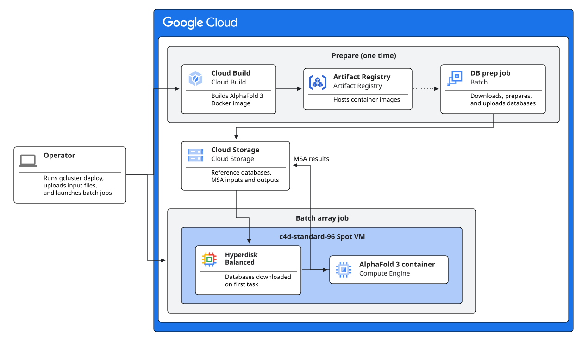

# AlphaFold 3 Multiple Sequence Alignment on Google Cloud Batch

*A high-throughput, I/O-optimized, cost-efficient reference solution for
AlphaFold 3 Multiple Sequence Alignment  (a.k.a "MSA" or "data pipeline") on
Google Cloud.*

AlphaFold 3's MSA step is a computationally intensive, CPU- and read-I/O-bound
workload that detects co-evolutionary patterns across homologous sequences to
inform structure prediction.

Although MSA is not required for folding, and does not apply to all use cases,
most users enable MSA as it dramatically improves predicted structural accuracy
and confidence scores. Because the time spent in the data pipeline step often exceeds
that of the GPU-bound inference step, users benefit from pre-computing the MSA
results and performing inference separately to avoid idling GPUs.

This solution implements that pattern using Google's
[Cluster Toolkit](https://docs.cloud.google.com/cluster-toolkit/docs/overview). A
single blueprint provisions the required infrastructure, builds the AlphaFold 3
Docker image
[from the GitHub repository](https://github.com/google-deepmind/alphafold3), and
prepares Cloud Batch array jobs to 1) download, prepare, and stage the reference
databases in a GCS bucket, and 2) execute the data pipeline in Spot VMs using a
Batch [array job]().

## 1. What the solution provides

* **Simple configuration and deployment**: All deployment parameters - including
  project, region, AlphaFold 3 version, task count, and task parallelism - are
  declared as `vars` in [`af3-msa.yaml`](af3-msa.yaml). Cluster Toolkit enables
  the required APIs, provisions storage and network resources, sets up
  `c4d-standard-96` instance templates, prepares Cloud Batch job definitions,
  and triggers Cloud Build to build the AlphaFold 3 Docker image.

* **Reference database preparation**:
  A one-time Cloud Batch job retrieves the AlphaFold 3 reference databases,
  shards RNA databases for optimal parallel search, packages structural
  templates into a compressed SquashFS image, and writes the results to Cloud
  Storage.

* **I/O-optimized alignment**:
  A Cloud Batch array job handles queueing, execution, and automatic retry of
  data pipeline tasks. Each `c4d-standard-96` worker VM provisions a 600 GB
  [Hyperdisk Balanced](https://cloud.google.com/compute/docs/disks/hyperdisk#hyperdisk-balanced)
  boot disk (with 50,000 IOPS and 2,400 MiB/s dedicated throughput). On startup,
  each VM stages the reference databases (~500 GB) to its hyperdisk. After the
  first task is run, ~250 GB protein FASTA databases stay cached in the VM's
  page cache, allowing subsequent tasks on the VM to read directly from
  memory. CPU and thread allocations and RNA databases have been optimized to
  fully utilize the 96 CPUs on each VM.

* **Predictable, low cost (~$0.42 per task)**:
  The solution runs on discounted Spot VMs, with Cloud Batch automatically
  handling retries if instances are preempted. When the job completes, Cloud
  Batch scales VMs down to zero, so the Cloud Storage bucket is the only
  persistent cost.

## 2. Solution architecture and design highlights



1. **Build**: Cloud Build builds the AlphaFold 3 Docker image and publishes it to
   Artifact Registry.

2. **Prepare**: When launched by the user, the database preparation job
   downloads the compressed reference databases, shards the RNA databases
   in parallel, builds a zstd-compressed `pdb_mmcif.squashfs`
   read-only filesystem image, and upload the results to the bucket.

3. **Submit**: Input files are uploaded to `gs://<bucket>/msa-inputs/`, and the
   MSA array job is submitted with one task per input file.

4. **Align**: Cloud Batch provisions `c4d-standard-96` Spot VMs with a 600 GB
   Hyperdisk Balanced boot volume boosted to 50,000 IOPS and 2,400 MiB/s throughput.
   The first task scheduled on a VM synchronizes the databases and `pdb_mmcif.squashfs`
   concurrently from Cloud Storage to `/mnt/disks/hyperdisk`, loopback-mounts
   the SquashFS image to `/mnt/disks/hyperdisk/pdb_mmcif`, and writes a sentinel file.
   Subsequent tasks on the same VM verify the sentinel and mountpoint and skip
   the transfer. Each task then invokes `run_alphafold.py` with
   `--run_data_pipeline=true --run_inference=false`.

5. **Collect**: Results are written directly to `gs://<bucket>/msa-outputs/`
   through the container's Cloud Storage filesystem support.

> [!NOTE]
> Inference is out of scope for this solution. AlphaFold 3 model parameters are
> neither required nor downloaded.

### Design highlights

#### Cloud Batch and Spot VMs

Alignment tasks are mutually independent, require no inter-task communication,
and typically arrive in bursts. Cloud Batch provides the scheduling, queueing,
retry, and VM autoscaling required for this workload, and Spot VMs reduce compute
cost substantially relative to on-demand pricing. No cluster is provisioned,
operated, or billed between runs.

#### Database storage on Hyperdisk Balanced and in-memory page cache

Sharded/parallel search yields a speedup only where the underlying storage can
sustain the resulting read load, making storage throughput the primary design
constraint. The ~630 GB of reference data is stored durably in Cloud
Storage and staged locally on each task VM.

Each worker VM attaches a single 600 GB Hyperdisk Balanced boot disk configured
with **50,000 IOPS** and **2,400 MiB/s** throughput.

Both the FASTA reference databases and `pdb_mmcif.squashfs` (totaling ~467 GB)
reside directly on this high-speed volume under `/mnt/disks/hyperdisk`. This
eliminates the need for a secondary data disk, reduces storage management
overhead, avoids Hyperdisk Extreme or LSSD quotas, and achieves the target
throughput of 300 alignments per hour.

The trade-off is a cold-start transfer on the first task scheduled to each VM.
By downloading pre-sharded uncompressed RNA databases and parallel compressed `.zst`
protein archives directly to local Hyperdisk, initial VM staging completes in an
observed **~2.83 minutes**. Staggering downloads in waves avoids Cloud Storage
egress quota contention:

| Concurrent downloads | Total download size (~430 GB/VM) | Time to download at 200 Gbps (25 GB/s) |
| :---: | :---: | :---: |
| 1 | 430 GB | 1.28 min\* |
| 10 | 4.3 TB | 2.87 min |
| 50 | 21.5 TB | 14.33 min |
| 100 | 43 TB | 28.67 min |

\* *Limited by the VM network interface at approximately 5.6 GB/s rather than by
the egress quota.*

This solution targets approximately 50 concurrent VMs (staggered in waves of 10
VMs every 30 seconds), which minimizes Cloud Storage throttling and limits the
interval during which a task is exposed to preemption before performing useful
work. This is configurable with the `msa_parallelism` blueprint parameter.
Larger deployments within a single region require a different
staging strategy; see [Scaling considerations](#scaling-considerations).

#### Machine shape and task density

The solution uses `c4d-standard-96` VMs with one task per VM, for the
following reasons:

* **Performance and availability**: The C4 and C4D machine families deliver
  substantially higher compute performance than C3 and are generally available
  for Spot consumption.
* **Preemption exposure**: Larger machine shapes are preempted more frequently,
  and longer-running tasks are more likely to be interrupted. The 96 vCPU shape
  generally has a low historical preemption rate compared to larger shapes.
* **Task density and I/O demand**: Because the databases are sharded to occupy
  all available vCPUs, increasing task density does not change the aggregate
  read throughput of a VM. It reduces the vCPUs available to each task, which
  extends task runtime and increases preemption exposure.

On this machine shape, a large alignment of approximately 5,000 residues
completes in under 12 minutes. In production benchmarking across 50 concurrent
`c4d-standard-96` Spot VMs, this solution achieved an observed throughput of
**300.3 alignments per hour** (and steady-state throughput of **615.3 alignments per hour**)
on a heterogeneous workload averaging 1,052 residues per target.


#### Hybrid multi-core and sharded search

Sequence search in AlphaFold 3 uses `jackhmmer` (protein) and `nhmmer` (RNA).
Different tools exhibit different scaling characteristics under multi-threading
and file I/O:

* **Protein databases (Jackhmmer with 32 vCPUs per search)**:
  With recent optimizations to Jackhmmer multi-threading and process scaling,
  `jackhmmer` scales efficiently across multiple CPU cores on monolithic FASTA
  files, eliminating the need to split protein databases into hundreds of small
  shard files. Searching `uniref90`, `uniprot_cluster_annot`, and `mgnify`
  concurrently with `--jackhmmer_n_cpu=32` precisely occupies the machine's 96
  vCPUs (`3 × 32 = 96 vCPUs`) during the peak search phase with zero CPU
  oversubscription.

* **RNA databases (Nhmmer with single-threaded sharding)**:
  In contrast to Jackhmmer, `nhmmer` multi-threading suffers from internal lock
  contention and reader-thread bottlenecks when scanning large monolithic sequence
  files. Dividing RNA databases into smaller shards searched by single-threaded
  workers (`--nhmmer_n_cpu=1 --nhmmer_max_parallel_shards=24`) avoids thread
  locking, reducing CPU core-hours by >4x and wall-clock time by ~3.1x:
  - `rfam` (138 Mbases): **16 shards** (1 batch of 16)
  - `rnacentral` (13.3 Gbases): **64 shards** (2 batches of 24 + 1 batch of 16)
  - `nt_rna` (76.8 Gbases): **384 shards** (16 batches of 24)

RNA shard counts are declared in two locations and must remain consistent: the
`fetch_and_shard_db` invocations in [`src/db_prep.sh`](src/db_prep.sh), and the
`<database>@<count>` arguments in the MSA runnable in [`af3-msa.yaml`](af3-msa.yaml).

#### Low cost

Estimated cost for the benchmark workload (300 targets averaging ~1,052 residues
each, aligned across 50 concurrent `c4d-standard-96` Spot VMs completing in ~60
minutes / ~50 VM-hours):

> [!NOTE]
> The figures below are estimates based on Google Cloud list pricing at the time
> of writing. Actual costs may vary based on dynamic Spot VM pricing fluctuations,
> discounts, or regional rate updates.

| Component | Sizing / Provisioning | Rate (`europe-west4`) | ~60-Min Benchmark Cost | Cost per alignment | % of Total |
| :--- | :--- | :--- | :--- | :--- | :--- |
| **Compute Engine (Spot)** | 50 × `c4d-standard-96` (96 vCPUs, 384 GB) | ~$1.97 / VM-hr | ~$98.50 | ~$0.328 | 78.9% |
| **Hyperdisk Balanced (Boot)** | 50 × 600 GB (50,000 IOPS, 2,400 MiB/s) | ~$0.50 / disk-hr\* | ~$25.00 | ~$0.083 | 20.0% |
| **Networking & Ephemeral IPs** | 50 external IPv4 + Tier 1 egress bandwidth | ~$0.025 / VM-hr | ~$1.25 | ~$0.004 | 1.0% |
| **Cloud Batch & GCS Egress** | Orchestration + in-region data sync (~430 GB/VM) | Free / $0.00 per GB | <$0.05 | <$0.001 | <0.1% |
| **Total** | | | **~$124.80** | **~$0.416** | **100%** |

\* *Provisioned for high throughput (50,000 IOPS and 2,400 MiB/s). Using Hyperdisk Balanced instead of Hyperdisk Extreme saves ~45% in total run cost while delivering equivalent compute throughput.*

* **Spot vs. On-Demand**: Using on-demand VMs ($4.76/hr) increases total benchmark cost to **~$264.30** (~**$0.88 per alignment**).
* **Persistent Storage**: Retaining the ~630 GB reference databases in a standard Cloud Storage bucket costs approximately **$12.60 / month** in `europe-west4`.
* **One-Time Database Preparation**: Running [`submit-db-prep-job.sh`](#step-2-prepare-the-reference-databases) once beforehand (1 on-demand `c4d-standard-96` with 1,500 GB Hyperdisk Balanced for ~12 minutes) incurs a one-time cost of approximately **$1.85**.


## 3. Getting started

### Prerequisites

* **Google Cloud SDK**. See the
  [installation guide](https://cloud.google.com/sdk/docs/install). Make sure to
  authenticate via the gcloud CLI:

  ```bash
  gcloud auth login

  # Grant Application Default Credentials to Terraform
  # (skip if running in Cloud Shell or on a GCE VM)
  gcloud auth application-default login
  ```

* **Cluster Toolkit (`gcluster`) v1.107.0 or later, and Terraform**. See the
  [Cluster Toolkit setup documentation](https://docs.cloud.google.com/cluster-toolkit/docs/setup/configure-environment).
  The directory containing the `gcluster` binary must be on `PATH`.

* **A Google Cloud project** with the Service Usage, Cloud Resource Manager, and
  Secret Manager APIs enabled. The blueprint enables the remaining APIs:
  Artifact Registry, Batch, Cloud Build, Compute Engine, and Cloud Storage.

* **Sufficient quota** for C4D vCPUs (Spot for alignment tasks; on-demand by
  default for the one-time database prep job) and Hyperdisk Balanced
  (`HDB_TOTAL_GB`) in the target region. Each alignment task VM consumes 96
  vCPUs and 600 GB of Hyperdisk Balanced (30,000 GB across 50 concurrent VMs),
  while the one-time database preparation VM temporarily uses 96 vCPUs and
  1,500 GB of Hyperdisk Balanced.

### Billing

> [!WARNING]
> The following services are used by this solution. Charges accrue as resources
> are created and used.

* Cloud Build
* Artifact Registry
* Cloud Batch
* Compute Engine (Spot and on-demand VMs and Hyperdisk Balanced boot disks)
* Cloud Storage

The bucket retains approximately 630 GB of sharded databases and structure
archives after the jobs complete and continues to incur storage charges. See the
[pricing page](https://cloud.google.com/products/pricing) for details.

### Configure and deploy the solution

#### Get the solution

Clone the repository and change into this solution's directory:

```bash
git clone https://github.com/GoogleCloudPlatform/hpc-solutions.git
cd hpc-solutions/solutions/alphafold3/msa
```

> [!NOTE]
> If you are using [Cloud Shell](https://shell.cloud.google.com/), `gcloud` and
> `git` are preinstalled, but Terraform and `gcluster` are not.
> Install both as described in the [prerequisites](#prerequisites) before
> continuing. The Cloud Shell home directory persists between sessions, so the
> cloned repo, the installed binaries, and the deployment directory will
> persist.

#### Configure blueprint

Configure the blueprint variables in `af3-msa.yaml` for your use case:

1. **`project_id`**: Set your Google Cloud project ID (or provide via `--vars project_id=YOUR_PROJECT_ID` when deploying).
2. **`region`**: Set your target GCP region (e.g., `europe-west4` or `us-central1`).
3. **`deployment_name`**: Set the name for your deployment folder and resources (defaults to `af3-msa`)
4. **`msa_task_count`**: Set your desired number of alignment inputs (e.g., `13` if running the bundled `example-targets.jsonl`).

#### Deploy blueprint

Deploy the blueprint using Cluster Toolkit:

```bash
gcluster deploy af3-msa.yaml --vars project_id=YOUR_PROJECT_ID
```

By default, `gcluster` creates the deployment directory in the current working
directory (`./<deployment_name>`). You can specify a custom deployment directory
using the `-o` / `--output` flag (e.g.:
`gcluster deploy af3-msa.yaml --vars project_id=YOUR_PROJECT_ID -o /path/to/deployments`
).

Upon successful deployment, `gcluster` prints next-step instructions (including
the exact Cloud Storage bucket path, Cloud Batch job IDs, and job submission
commands) directly in the terminal, and writes `NEXT_STEPS.txt` into the
deployment's batch directory (`<deployment_directory>/batch/NEXT_STEPS.txt`).

Any blueprint variable declared in [`af3-msa.yaml`](af3-msa.yaml) (e.g. 
`deployment_name`, `region`, `af3_version`, `msa_task_count`, `msa_parallelism`,
`msa_disk_size_gb`, `db_prep_spot`, and `msa_spot`) can be overridden on the
command line using `--vars`:

```bash
gcluster deploy af3-msa.yaml --vars project_id=YOUR_PROJECT_ID,region=europe-west4,msa_task_count=13
```

To destroy the deployment and tear down resources, run:

```bash
gcluster destroy <deployment_directory> --auto-approve
```

#### Upload input files

Upload your input files to the prefix printed in the deployment instructions
(or in `NEXT_STEPS.txt`). Your input files should be named as sequential
integers starting at zero, e.g. `0.json`, `1.json`, ..., `<N-1>.json`.

```bash
gcloud storage cp /path/to/targets/*.json gs://<bucket>/msa-inputs/
```

For a demo run (or if your targets are stored in a JSONL file), expand and
upload the bundled [`example-targets.jsonl`](example-targets.jsonl) (13 inputs,
`0.json`–`12.json`; set `msa_task_count: 13`):

```bash
d=$(mktemp -d) && awk -v d="$d" '{f=d"/"(NR-1)".json"; print > f; close(f)}' example-targets.jsonl && gcloud storage cp "$d"/*.json gs://<bucket>/msa-inputs/ && rm -rf "$d"
```

### Prepare the reference databases

Run the database preparation job from the deployment directory printed in the
deployment instructions:

```bash
(cd "<deployment_directory>/batch" && ./submit-db-prep-job.sh)
```

The job provisions an on-demand `c4d-standard-96` VM with a 1,500 GB Hyperdisk
Balanced volume and executes [`src/db_prep.sh`](src/db_prep.sh), which:

1. downloads the compressed `.zst` reference databases onto Hyperdisk Balanced using multi-connection `aria2c`;
2. streams `zstd` decompression of the RNA databases directly into SeqKit (`seqkit split2 --by-part`), applying the AlphaFold 3 shard naming format (`<database>-<NNNNN>-of-<NNNNN>`);
3. packages mmCIF structures into a compressed read-only SquashFS image (`pdb_mmcif.squashfs`, ~60 GB) using `mksquashfs -comp zstd`;
4. uploads the compressed protein `.zst` archives, sharded RNA databases, and `pdb_mmcif.squashfs` to the Cloud Storage bucket using `gcloud storage cp` with parallel composite uploads.

This job is run once per deployment, completing in approximately 12 minutes as
it transfers, rewrites, and re-uploads several hundred gigabytes. The resulting
bucket contents are durable; the VM and its 1,500 GB Hyperdisk Balanced volume
are deleted on completion.

### Run alignments

Confirm that your inputs are in place, that `db-prep-job` has
succeeded, and that `msa_task_count` matches the number of inputs, then submit
the array job:

```bash
(cd "<deployment_directory>/batch" && ./submit-msa-array-job.sh)
```

Each redeployment regenerates the submit scripts with a new job ID, so redeploy
before submitting a second run. Results are written to
`gs://<bucket>/msa-outputs/<input_name>/`.


<a id="scaling-considerations"></a>

## 4. Scaling considerations

**Deployments exceeding approximately 50 concurrent VMs per region.** The
cold-start transfer from GCS becomes the limiting factor. Mitigations include
distributing the workload across regions, or hosting the databases on a shared
[Hyperdisk ML](https://docs.cloud.google.com/compute/docs/disks/hyperdisk-ml-about),
which supports substantially more concurrent readers. Hyperdisk ML volumes are
zonal (which reduces Spot VM availability), must be populated from an attached
VM or a snapshot, and are billed for provisioned throughput - so a volume must
be deleted once a run is complete.

**Additional or proprietary databases.** [`src/db_prep.sh`](src/db_prep.sh) can
be modified to download, shard (if needed), and upload additional databases;
make sure to also modify [`src/download_msa_dbs.sh`](src/download_msa_dbs.sh)
and add the corresponding `--*_database_path` and `--*_z_value` flags
to the MSA command in [`af3-msa.yaml`](af3-msa.yaml). Shard counts should
remain multiples of the applicable `max_parallel_shards` value.

## 5. Cleanup

Destroy the deployment once the workload is complete:

```bash
gcluster destroy "<deployment_directory>" --auto-approve
```

> [!CAUTION]
> The Cloud Storage bucket retains the sharded databases and the alignment
> results, and **continues to incur charges** after the remaining infrastructure
> is destroyed. Download any data to be retained, then delete the bucket
> explicitly.

## 6. Software licenses

| Component | License | Upstream project |
| :--- | :--- | :--- |
| **AlphaFold 3** (source code) | Apache 2.0 | [google-deepmind/alphafold3](https://github.com/google-deepmind/alphafold3) |
| **aria2** (`aria2c`) | GPL-2.0-or-later | [aria2/aria2](https://github.com/aria2/aria2) |
| **gcsfs** | BSD-3-Clause | [fsspec/gcsfs](https://github.com/fsspec/gcsfs) |
| **HMMER** (`jackhmmer`, `nhmmer`, `hmmsearch`) | BSD-3-Clause | [Eddy-Lab/hmmer](https://github.com/Eddy-Lab/hmmer) |
| **SeqKit** | MIT | [shenwei356/seqkit](https://github.com/shenwei356/seqkit) |
| **SquashFS Tools** (`mksquashfs`) | GPL-2.0-or-later | [plougher/squashfs-tools](https://github.com/plougher/squashfs-tools) |
| **uv** (benchmarking) | Apache 2.0 / MIT | [astral-sh/uv](https://github.com/astral-sh/uv) |
| **Zstandard** (`zstd`) | BSD-3-Clause / GPL-2.0 | [facebook/zstd](https://github.com/facebook/zstd) |

AlphaFold 3 model parameters are subject to separate
[terms of use](https://github.com/google-deepmind/alphafold3/blob/main/WEIGHTS_TERMS_OF_USE.md)
and are not used by this solution, which runs the data pipeline only. The genetic
databases are subject to their own licenses and terms; the set retrieved is
listed in
[`fetch_databases.sh`](https://github.com/google-deepmind/alphafold3/blob/main/fetch_databases.sh)
in the AlphaFold 3 repository.

